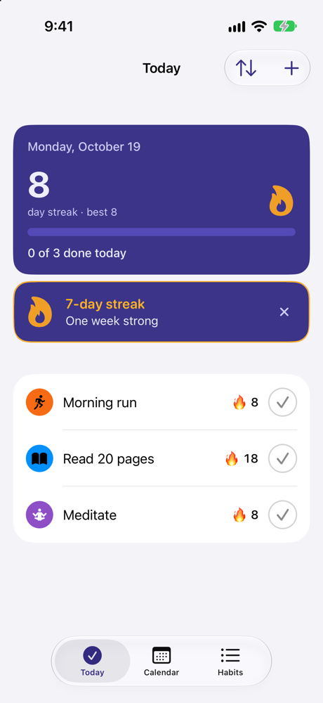
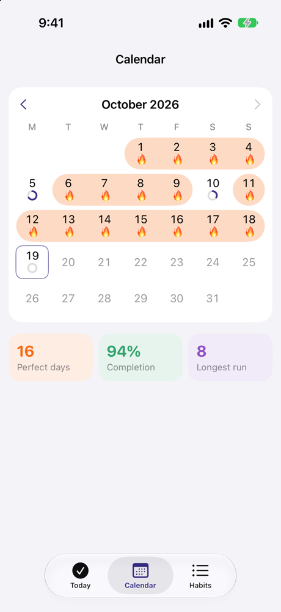
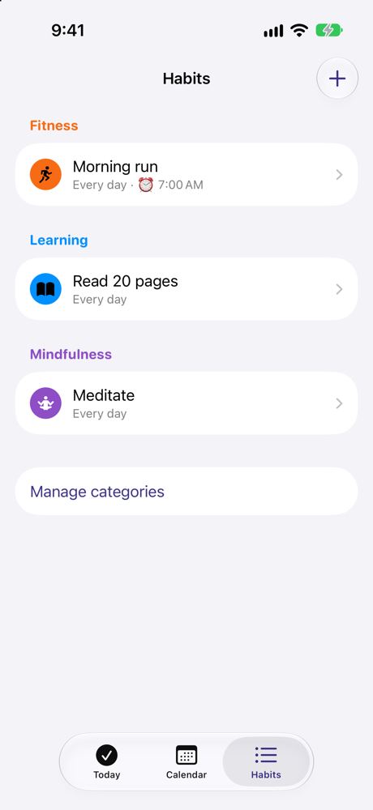
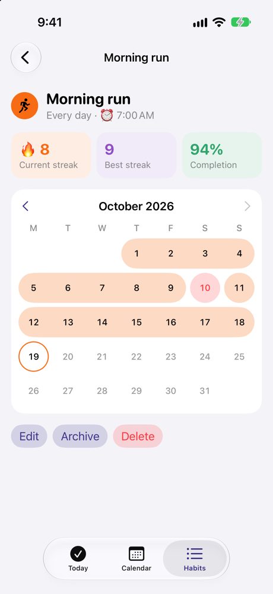
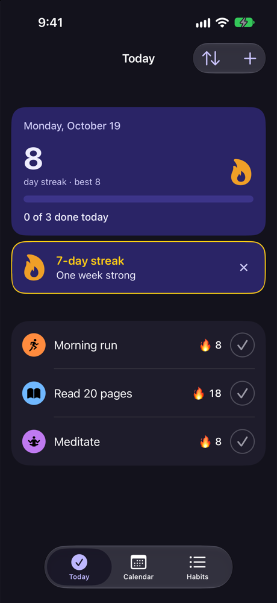
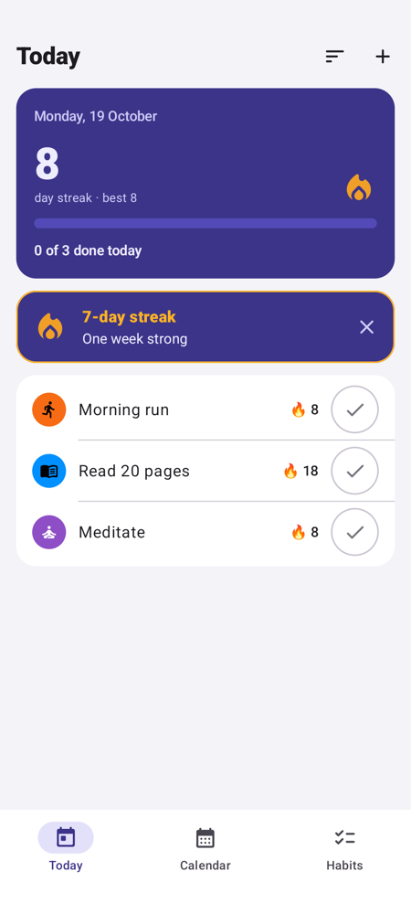
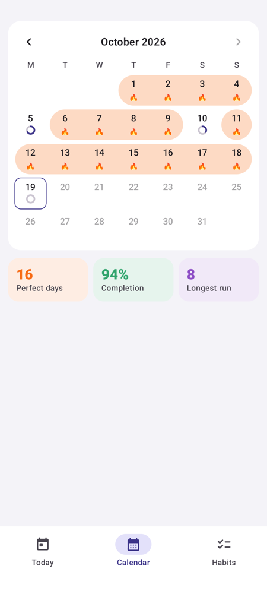
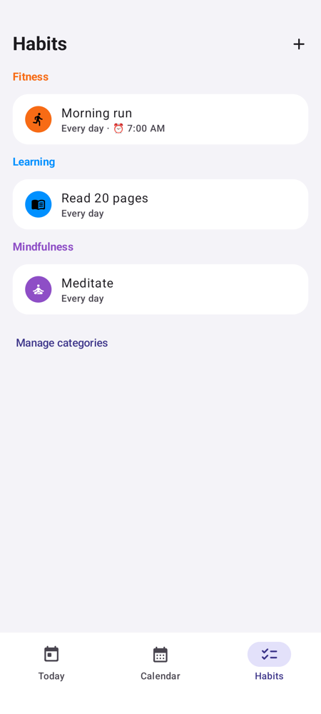
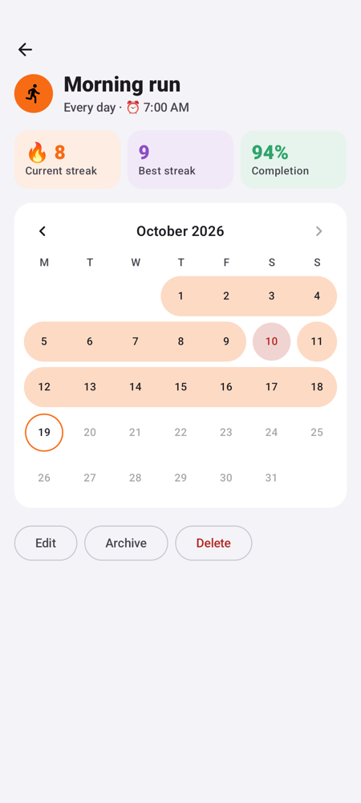
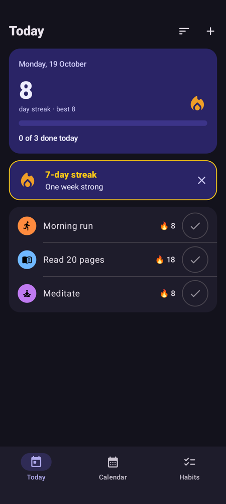

# Habit Tracker

An offline-first habit tracker built with Kotlin Multiplatform. The domain
logic, data layer and ViewModels are shared; the UI is SwiftUI on iOS and
Jetpack Compose on Android. It is a personal project for daily use and learning.

## Features

- Dashboard with today's habits and progress
- Streaks (current and best)
- Weekday schedules per habit
- Categories with colors and icons
- Calendar with 🔥 marking perfect days
- Habit detail screen
- Archive for habits you no longer track
- Reminders: one optional time per habit, only on scheduled days, skipped if
  the habit is already done, with a "Mark done" action on the notification
- Bold Today screen with confetti when you finish the day and streak
  milestones at 7, 30, 100 and 365 days (iOS and Android).

All data is stored locally on the device.

### Reminder permissions

- **iOS:** the app asks for notification permission the first time you turn
  on "Remind me". If you deny it, the form shows a note with a link to
  Settings.
- **Android:** on Android 13+ the app asks for `POST_NOTIFICATIONS` the same
  way. Reminders use exact alarms when the system allows them
  (`SCHEDULE_EXACT_ALARM`, off by default on Android 14+). Otherwise they
  fall back to inexact alarms, which can arrive a few minutes late.
  Alarms are re-planned after a reboot.
- Reminders are planned 7 days ahead (at most 60 at a time) and refreshed
  whenever habits or completions change.

## Screenshots

The sample data shows an 8-day streak, so Today displays the 7-day milestone card.

**iPhone (SwiftUI)**

<table>
<tr><th>Today</th><th>Calendar</th><th>Habits</th><th>Habit detail</th><th>Dark mode</th></tr>
<tr><td></td><td></td><td></td><td></td><td></td></tr>
</table>

**Android (Jetpack Compose)**

<table>
<tr><th>Today</th><th>Calendar</th><th>Habits</th><th>Habit detail</th><th>Dark mode</th></tr>
<tr><td></td><td></td><td></td><td></td><td></td></tr>
</table>

## Architecture

```
androidApp (Compose)      iosApp (SwiftUI)
        \                   /
         v                 v
   shared/
     presentation   ViewModels, UI state
          |
        domain      models, rules, repository interfaces
          ^
         data       database, repository implementations
     di             wiring (depends on all layers)
```

Dependency rule: `domain` imports only the allowed standard/kotlinx libraries,
never `data` or `presentation`; `presentation` never imports `data`; `di` wires
the layers together; the two apps depend on `shared`. An architecture test (`shared/src/androidHostTest/kotlin/app/habittracker/ArchitectureTest.kt`)
enforces this and fails the build if a layer imports something it should not.

## Prerequisites

- JDK 17+ (the build was verified with JDK 22)
- Android SDK with compileSdk 37
- Xcode 27+ with its license accepted (`sudo xcodebuild -license accept`)
- xcodegen (`brew install xcodegen`)

The iOS `.xcodeproj` is generated from `iosApp/project.yml` and is not committed.

## Build and run

Android:

```
./gradlew :androidApp:installDebug
```

or open the repo root in Android Studio and run the `androidApp` configuration.

iOS:

```
cd iosApp
xcodegen
open HabitTracker.xcodeproj
```

then run the `HabitTracker` scheme, or build from the command line with
`xcodebuild` (see below).

## Testing

```
# Shared tests (JVM host + iOS simulator), Android unit tests, Android build
./gradlew :shared:allTests :androidApp:testDebugUnitTest :androidApp:assembleDebug

# Android instrumented tests (needs a running emulator or device)
./gradlew :androidApp:connectedDebugAndroidTest

# iOS unit + UI tests
cd iosApp && xcodegen && xcodebuild test -scheme HabitTracker \
  -destination 'platform=iOS Simulator,id=<simulator-udid>'
```

What each suite covers:

- Shared (JVM host and iOS simulator): domain rules, streak and schedule
  logic, repositories against an in-memory database, ViewModels, and the
  architecture test.
- Android unit: Android-side mapping, schedule summary and form-store tests.
- Android instrumented: end-to-end Compose smoke test (create a habit, toggle
  it, check progress), run through the Android Test Orchestrator.
- iOS unit: Swift-side mapping, grid and contrast tests.
- iOS UI: XCUITest flows, launched with `-uiTestResetDB` so each run starts
  from an empty database.

## Docs

- Design spec: [docs/design/2026-10-18-habit-tracker-design.md](docs/design/2026-10-18-habit-tracker-design.md)
- Implementation plan: [docs/plans/2026-10-18-habit-tracker.md](docs/plans/2026-10-18-habit-tracker.md)
- Reminders spec: [docs/design/2026-10-19-reminders-design.md](docs/design/2026-10-19-reminders-design.md)
- Reminders plan: [docs/plans/2026-10-19-reminders.md](docs/plans/2026-10-19-reminders.md)

## Known limitations (v1)

- No sync between devices or accounts
- No home-screen widgets
- iOS verification was done on the "iPhone Duo" simulator running iOS 27.1;
  other devices have not been checked
